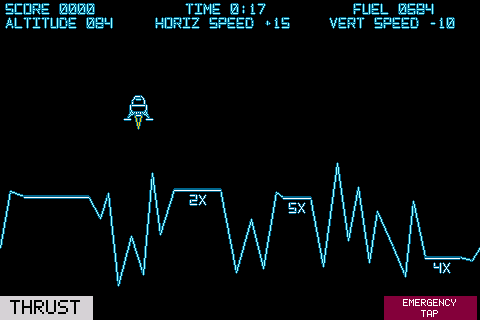
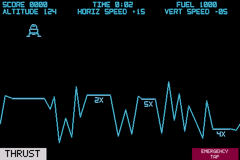
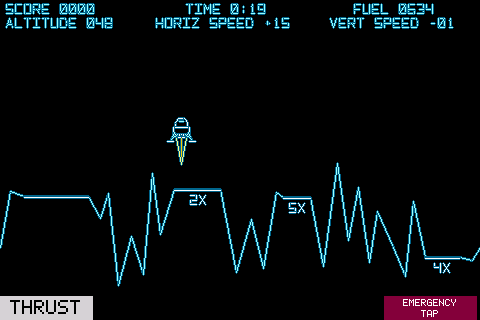
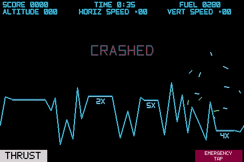
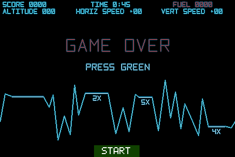
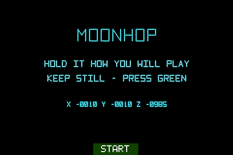
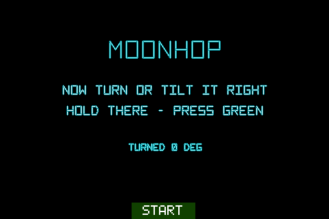
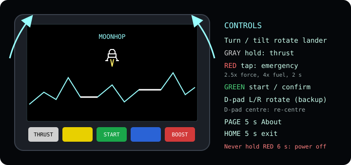
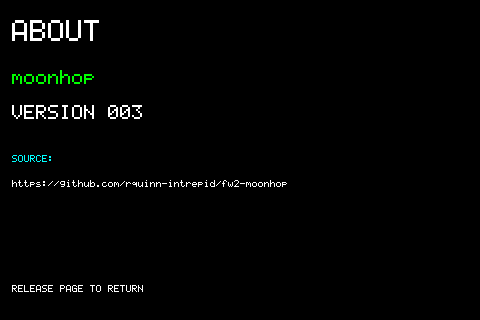

# moonhop

**A vector-style moon landing game for the FreeWili 2.**
Glowing cyan lines on black, a jagged mountain range that changes every stage,
and four landing pads worth 1x, 2X, 4X and 5X. Turn the board to rotate the
lander, feather the thrust, and set it down gently.

<p align="center">
  
</p>

---

## Screenshots

<table>
  <tr>
    <td align="center"><br><sub>Drifting in over the pads</sub></td>
    <td align="center"><br><sub>Emergency thrust (red)</sub></td>
  </tr>
  <tr>
    <td align="center"><br><sub>Crash: the lander breaks into vector debris</sub></td>
    <td align="center"><br><sub>Out of fuel: game over</sub></td>
  </tr>
  <tr>
    <td align="center"><br><sub>Setup 1: hold it how you will play</sub></td>
    <td align="center"><br><sub>Setup 2: turn or tilt right</sub></td>
  </tr>
</table>

## Controls

<p align="center"></p>

| Input | Action |
| --- | --- |
| **Turn or tilt** the board | Rotate the lander |
| Hold **GRAY** | Thrust (about 3x moon gravity) |
| Tap **RED** | Emergency thrust: 2.5x force, burns fuel 4x faster, cuts out after 2 s |
| **GREEN** | Start / confirm |
| D-pad left / right | Rotate (backup); D-pad centre re-centres steering |
| Hold **PAGE** 5 s | About screen (game pauses) |
| Hold **HOME** 5 s | Back to the FreeWili menu |

> **Tap red, don't hold it.** Holding red for 6 seconds powers the FreeWili 2
> off. The emergency burst stops after 2 s so there is never a reason to.

## How to play

1. Open **moonhop** from the board's App Explorer.
2. **Setup.** Hold the board the way you will play, keep still, press GREEN.
   Then turn or tilt it to the right (watch `TURNED __ DEG` climb), hold it
   there and press GREEN. The game learns which motion you use:
   - *turning* the board (for example flat on a table) steers with the gyro;
   - *tilting* it steers with the accelerometer.
3. **Fly.** The lander starts high with some sideways drift. Rotate against the
   drift and use GRAY to brake.
4. **Land** with both feet on a flat pad, within ±10° of upright, slowly.

| Pad | Points |
| --- | --- |
| unmarked | 100 |
| 2X | 200 |
| 4X | 400 |
| 5X (narrowest, up on the peaks) | 500 |

- A safe landing adds **150 fuel**, shows `LANDED!` and moves to new terrain.
- A crash (rocks, too fast, too tilted) costs **300 fuel**; you retry the same
  terrain. **Game over** when fuel reaches 0.
- Fly off one side of the screen and you come back on the other.
- **Bottom-heavy:** with the engine off, small tilts (up to 12°) are ignored
  and the lander rights itself, so a slightly unsteady hand does not tip you
  into a crash. Steering while thrusting is unchanged.

## Sound and lights

- A low rumble while thrusting (louder for emergency thrust) and an explosion
  on a crash, synthesized on the board and kept well under the speaker's
  0.5 W limit. The speaker powers down when it is quiet.
- The RGB LEDs glow with thrust, flash red on a crash and green on a landing.

## Build and install

```bash
git clone --recurse-submodules https://github.com/rquinn-intrepid/fw2-moonhop.git
cd fw2-moonhop
```

Needs the Pico SDK 2.3.0 toolchain under `~/.pico-sdk`, Python 3, CMake and
Ninja (see `wilibsp/README.md`); for `tools\dev test` on Windows, MSYS2's
mingw64 GCC.

| Command | What it does |
| --- | --- |
| `tools\dev build` | Build `build/moonhop.uf2` |
| `tools\dev run` | Build, load into the board over USB and start it (gone after a reboot) |
| `tools\dev install` | Copy the UF2 to the SD card's `/apps/` so it is in the app list |
| `tools\dev test` | Host unit tests for the game rules |
| `tools\dev screenshot -o shot.png` | Any other wilibsp `fw` command works too |

## Project layout

```
src/mh_game.c   game rules: terrain, physics, landing, scoring (pure C, host-tested)
src/main.c      board side: renderer, stroke font, IMU steering, sound, LEDs
tests/          host unit tests (tools\dev test)
docs/           hardware check notes and these images
wilibsp/        FreeWili 2 board support, pinned submodule
```

Built on [wilibsp](https://github.com/freewili/wilibsp), the FreeWili 2 board
support package. What was and was not checked on real hardware is recorded in
[docs/2026-11-19-moonhop-e2e.md](docs/2026-11-19-moonhop-e2e.md).

<p align="center"></p>
